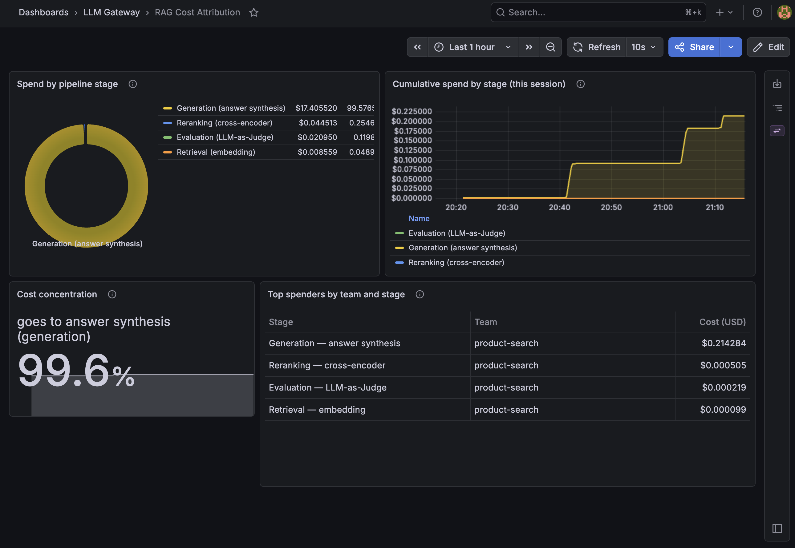
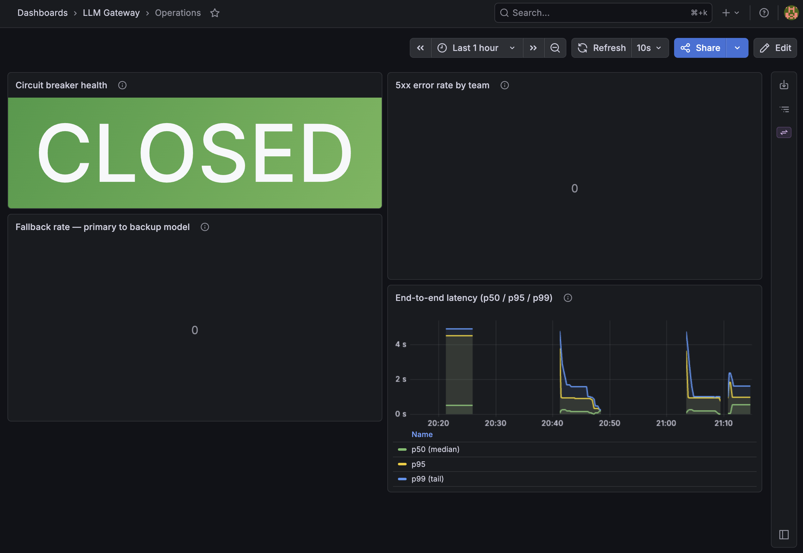
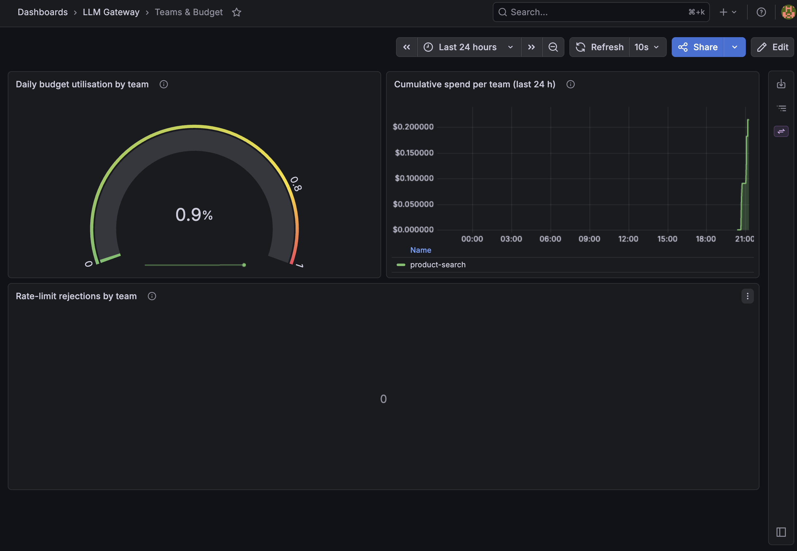
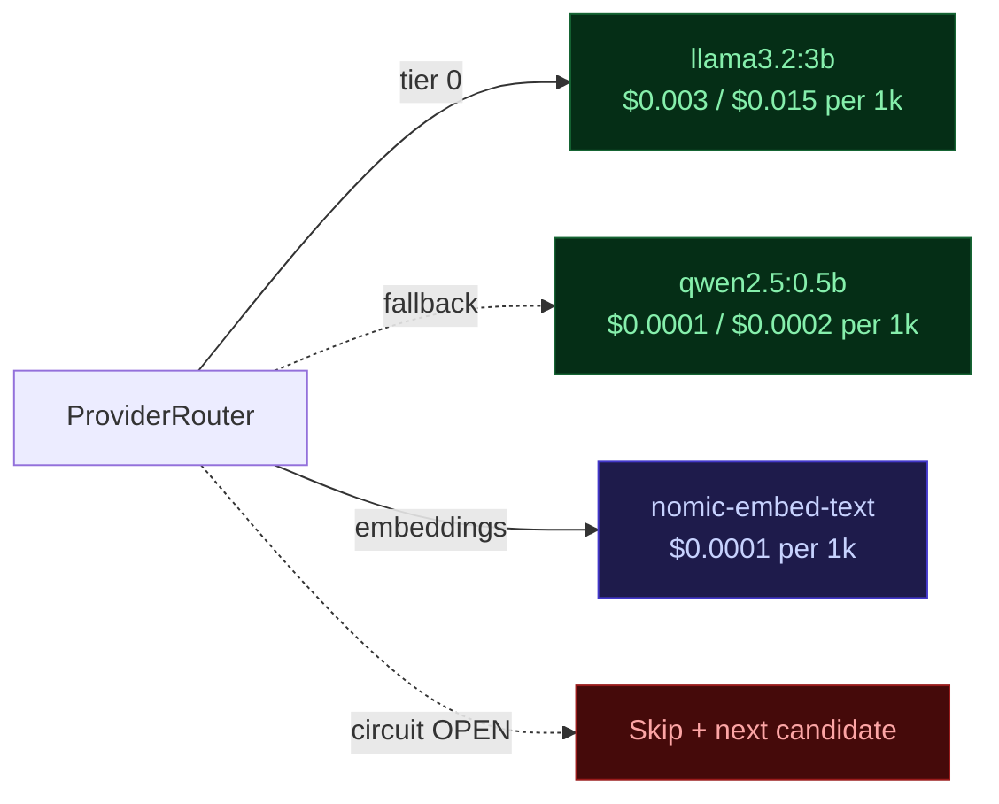

# LLM Gateway

> RAG-aware LLM gateway — breaks down spend by retrieval / reranking / generation / evaluation, so you know which stage is consuming your budget, not just which model.

[](https://github.com/adel-saoud/llm-gateway/actions/workflows/ci.yml)
[](https://www.python.org/)
[](https://github.com/astral-sh/ruff)
[](https://github.com/microsoft/pyright)
[](pyproject.toml)
[](LICENSE)

---

Production RAG cost breaks down across four operation types — retrieval (embeddings), reranking (cross-encoder calls), generation (answer synthesis), and evaluation (LLM-as-Judge). LiteLLM, PortKey, and OpenRouter all answer *"how much did I spend per model?"* — they're excellent at that.

**This gateway answers a different question: which stage of my RAG pipeline is consuming my budget?** Every request is classified into one of those four operation types by a 5-priority tagger, costs are recorded per-team-per-operation in a SQLite ledger, and a `/v1/rag/cost-report` endpoint plus a pre-provisioned Grafana dashboard surface the breakdown in real time.

Runs end-to-end with **Ollama** — zero API keys, zero cost, no data leaves the host.

> Directly inspired by operating a production RAG system at Decathlon France — serving 30,000+ employees where understanding cost-per-operation was critical to making architecture decisions (cheaper embeddings? smaller reranker? colder cache?). This is that pattern, open-sourced.

**What you get out of the box:**

| Feature | What it does |
|:--|:--|
| **RAG cost attribution** | Classifies every request into retrieval / reranking / generation / evaluation; records cost per team per operation; exposes `GET /v1/rag/cost-report` |
| **Smart model routing** | HIGH_QUALITY requests automatically fall back to the BUDGET model if the primary is unavailable — no code change required |
| **Circuit breaker** | Three-state (CLOSED → OPEN → HALF_OPEN) per `(provider, model)`, SQLite-persisted across restarts, auto-probes after the open-duration elapses |
| **Redis rate limiting** | Atomic Lua token bucket — exact capacity enforcement even under concurrent load; returns `429` with `Retry-After` |
| **Per-team budget caps** | Warn at 80%, block at 100% of the daily budget; every enforcement event is structured-logged |
| **Live admin API** | `PUT /v1/admin/teams/{id}` reloads team config without a restart |
| **3 Grafana dashboards** | RAG cost attribution · Operations (circuit state + fallback rate + latency) · Teams & Budget — all pre-provisioned, populated by `make demo-full` |
| **OpenAI-compatible** | Drop-in replacement for any client that speaks the OpenAI chat/embeddings wire format |


---

## Try it — no API key needed

```bash
git clone https://github.com/adel-saoud/llm-gateway
cd llm-gateway
```

**Option A — bundled Ollama** (pulls ~3 GB of models on first boot, cached afterwards):

```bash
make up        # build + start everything
make logs      # wait until "Application startup complete"
make demo      # run the 5-step RAG demo
```

**Option B — host Ollama** (you already have Ollama running locally with the models):

```bash
# Ensure the three required models are present:
#   ollama pull llama3.2:3b && ollama pull qwen2.5:0.5b && ollama pull nomic-embed-text
make up        # auto-creates docker-compose.override.yml that skips the bundled Ollama
make logs      # wait until "Application startup complete"
make demo      # run the 5-step RAG demo
```

> `make up` auto-detects `docker compose` (plugin) vs `docker-compose` (standalone) and
> enables BuildKit automatically. It also creates `docker-compose.override.yml` and
> `config/teams.yaml` from their example files if they don't exist.

Other useful targets:

```bash
make down             # stop containers (volumes preserved)
make reset            # tear down everything including volumes, rebuild from scratch
make test             # run the full hermetic test suite (no Docker needed)
make check            # lint + format + type-check + tests (all four CI gates)
make load-test        # 1 000-request load test — prints cost savings % + latency percentiles
make demo-resilience  # trip the circuit breaker and show the OPEN→HALF_OPEN→CLOSED cycle
make demo-full        # run all demos in sequence: RAG → load test → resilience
```

Expected output:

```
LLM Gateway — RAG demo
Base URL:        http://localhost:8000
Embedding model: nomic-embed-text
Budget model:    qwen2.5:0.5b
Quality model:   llama3.2:3b

── 1. Retrieval (embedding) ─────────────────────────────────────
  → 200  model=nomic-embed-text  op=retrieval  cost=$0.000001

── 2. Retrieval — chunk embeddings ──────────────────────────────
  → 200  model=nomic-embed-text  op=retrieval  cost=$0.000002
  → 200  model=nomic-embed-text  op=retrieval  cost=$0.000003
  → 200  model=nomic-embed-text  op=retrieval  cost=$0.000002

── 3. Reranking ─────────────────────────────────────────────────
  → 200  model=qwen2.5:0.5b  op=reranking  cost=$0.000007

── 4. Generation ────────────────────────────────────────────────
  → 200  model=llama3.2:3b  op=generation  cost=$0.001143

── 5. Evaluation (LLM-as-Judge) ─────────────────────────────────
  → 200  model=qwen2.5:0.5b  op=evaluation  cost=$0.000004

── 6. RAG cost breakdown for this team today ───────────────────
  Total cost: $0.001162
    retrieval    $0.000008  (  0.7%)
    reranking    $0.000007  (  0.6%)
    generation   $0.001143  ( 98.4%)
    evaluation   $0.000004  (  0.4%)

View the live dashboard:  http://localhost:3000/d/rag-cost-attribution
```

### Dashboards — all three populated after `make demo-full`

**RAG Cost Attribution** — where your AI budget actually goes, broken down by pipeline stage:



**Operations** — circuit breaker state, fallback rate, error rate, latency percentiles:



**Teams & Budget** — per-team utilisation, daily spend, and rate-limit pressure:



Generate the headline cost-savings number against an all-high-quality baseline:

```bash
uv run python scripts/load_test.py --requests 1000
```

Expected output:

```
Sending 1000 requests against http://localhost:8000 …
  …100 / 1000
  …500 / 1000
  …1000 / 1000
============================================================
  Elapsed:           45.2s
  Requests / second: 22.1
  Success / fail:    1000 / 0
  Actual cost:       $0.084213
  Hypothetical cost: $0.231456  (if all-high-quality)
  COST SAVINGS:        63.62%
  Latency P50/P95/P99: 32.1 / 87.4 / 142.6  ms (round-trip)
============================================================
```

> Numbers come from the simulated cost tiers in [`config.py`](src/llm_gateway/config.py) (real routing logic, synthetic prices). The % savings is real — the dollar amounts are illustrative.

## Use it with your own setup

The gateway speaks the **OpenAI chat-completions and embeddings wire format** — anything that talks to OpenAI talks to this. Point your client at `http://localhost:8000/v1` and pass `Authorization: Bearer <your-team-api-key>`:

```python
from openai import OpenAI
client = OpenAI(base_url="http://localhost:8000/v1", api_key="sk-gw-...")
response = client.chat.completions.create(
    model="llama3.2:3b",
    messages=[{"role": "user", "content": "Hello"}],
    extra_headers={"X-Rag-Operation": "generation"},  # optional explicit tag
)
```

Every response carries gateway metadata in headers:

| Header | Example | Meaning |
|:--|:--|:--|
| `X-Gateway-Cost-USD` | `0.001143` | Cost of this request (simulated, matches the ledger) |
| `X-Gateway-Model-Used` | `llama3.2:3b` | Actual model that served the request (may differ if fallback fired) |
| `X-Gateway-Rag-Operation` | `generation` | Operation type the classifier assigned |

Teams live in [`config/teams.yaml`](config/teams.example.yaml) — copy the example file, replace the keys, restart. Per-team API key, allowed-model whitelist, rate limits, daily budget cap, and admin flag are all there. Live updates via `PUT /v1/admin/teams/{id}` — no restart.

---

## How it works

```mermaid
flowchart LR
    Client([Client request]) --> M[MetricsMiddleware<br/>auto-instrumented]
    M --> Auth[AuthMiddleware<br/>resolves team]
    Auth --> RL[RateLimitMiddleware<br/>Redis token bucket]
    RL --> Budget[BudgetEnforcer.check<br/>warn 80% · block 100%]
    Budget --> Tag[RAG classifier<br/>retrieval · rerank · generate · eval]
    Tag --> Router[ProviderRouter<br/>fallback chain + circuit breaker]
    Router --> Provider[Ollama HTTP]
    Provider --> Ledger[BudgetTracker.record<br/>SQLite cost ledger]
    Ledger --> Resp[Response + X-Gateway-* headers]

    style Client fill:#1f2937,stroke:#374151,color:#f9fafb
    style Provider fill:#052e16,stroke:#166534,color:#86efac
    style Tag fill:#1e1b4b,stroke:#4338ca,color:#c7d2fe
    style Ledger fill:#1e1b4b,stroke:#4338ca,color:#c7d2fe
```



`MetricsMiddleware` is outermost so it observes 401 / 429 rejections too. `AuthMiddleware` populates `request.state.team` from the Bearer token before rate-limit / budget consult it. All middleware is pure ASGI (not `BaseHTTPMiddleware`) so streaming SSE response bodies pass through unbuffered.

Full module map and design rationale → [`docs/architecture.md`](docs/architecture.md).

---

## Why not just use LiteLLM?

LiteLLM is an excellent production choice — this gateway solves an adjacent problem. Here's what's different:

| Problem | Approach |
|:--|:--|
| **Per-model cost only shows half the story** | 5-priority RAG operation classifier (`X-Rag-Operation` header → embedding-model signal → `judge`/`evaluate` keyword → `rerank` keyword → default `generation`). Every successful request lands in `cost_ledger` with its operation tag; `GET /v1/rag/cost-report` exposes the breakdown. |
| **`litellm` abstracts the wire contract away** | Custom async Ollama adapter — NDJSON streaming, per-model token counting from `prompt_eval_count` / `eval_count`, normalised error hierarchy (`ProviderError` / `ProviderTimeoutError` / `ProviderUnavailableError`). The HTTP contract is in your face, not hidden behind a router. |
| **Streaming + buffering middleware = corrupt SSE** | Pure-ASGI auth + rate-limit + metrics middleware that wraps the ASGI `send` channel directly. Chat-completion streams pass through unbuffered. |
| **In-memory rate limiters split-brain under load** | Atomic Redis Lua `EVALSHA` token bucket — read, refill, decrement, set TTL all in one round-trip. Tested with 40 concurrent acquires against capacity 20: exactly 20 ± 1 succeed. |
| **A restart resets the circuit breaker** | Three-state CB (`CLOSED` / `OPEN` / `HALF_OPEN`) persisted in SQLite. A process that comes back up while a downstream is `OPEN` still skips it until the open-duration elapses, then probes once via `HALF_OPEN`. |
| **Per-team budget caps usually live in spreadsheets** | `BudgetEnforcer.check` reads today's spend from the ledger per request, returns `OK` / `WARNING` / `BLOCKED`. Warn at 80%, block at 100%. Every check is `structlog`-logged. |
| **Dashboards are a separate project** | 3 pre-provisioned Grafana dashboards land on first `docker-compose up` — RAG cost attribution (donut + per-op timeseries), operations (circuit state · error rate · fallback rate · latency percentiles), teams & budget (utilisation gauges · daily cost · rate-limit pressure). |

---

## RAG cost attribution

The differentiating mechanic. Every chat/embed request is classified into one of:

| Type | Signal |
|:--|:--|
| `retrieval` | Embedding-model call **or** `X-Rag-Operation: retrieval` |
| `reranking` | System prompt contains `rerank` / `relevance`, or `X-Rag-Operation: reranking` |
| `generation` | Default for chat requests |
| `evaluation` | System prompt contains `judge` / `evaluate` / `score`, or `X-Rag-Operation: evaluation` |
| `unknown` | Reserved — bucketed only when an admin import lands a tag outside the vocabulary |

The classifier is a [pure function](src/llm_gateway/rag/tagger.py). Unknown header values intentionally fall through to the other signals — a typo doesn't poison attribution. The cost report endpoint always returns the four named operations (zero-filled if absent) and includes `unknown` only when it carries non-zero spend:

```json
{
  "team": "product-search",
  "date": "2026-05-23",
  "total_cost_usd": 0.847,
  "by_operation": {
    "retrieval":  0.12,
    "reranking":  0.08,
    "generation": 0.58,
    "evaluation": 0.067
  }
}
```

---

## Resilience — circuit breaker & fallback routing

Every HIGH_QUALITY model request automatically builds a two-candidate fallback chain: `llama3.2:3b → qwen2.5:0.5b`. If the primary fails or the circuit breaker is OPEN, the gateway routes to the budget model and records an `on_fallback` event — the caller receives a valid response, `X-Gateway-Model-Used` tells them which model actually served it.

The circuit breaker is a three-state machine persisted in SQLite:

```
CLOSED ──(failure rate > 50% over ≥10 requests)──► OPEN
  ▲                                                    │
  │                                              (30 s elapses)
  │                                                    ▼
  └────────(probe request succeeds)──────────── HALF_OPEN
```

State survives process restarts — a gateway that comes back up while a downstream is OPEN still skips it until the open-duration elapses, then sends exactly one probe.

Run the interactive demo to watch the full cycle:

```bash
make demo-resilience   # auto-stops/starts bundled Ollama; prompts for host Ollama
```

The **Operations dashboard** (`http://localhost:3000/d/operations`) shows circuit breaker state per model, fallback rate, error rate, and latency percentiles in real time.

---

## Configuration



Every model id lives in `Settings` (env vars) — no hardcoded model strings. The simulated cost tiers in [`config.py`](src/llm_gateway/config.py) drive routing and the dashboards; the dollar amounts are illustrative, the % savings reported by the load test are real.

All other tunables (`GATEWAY_PORT`, `GATEWAY_REDIS_URL`, `GATEWAY_CB_FAILURE_RATE_THRESHOLD`, `GATEWAY_CB_OPEN_DURATION_S`, …) are documented in [`.env.example`](.env.example).

---

## Project structure

```
src/llm_gateway/
├── config.py                 Settings — all env-driven via pydantic-settings
├── main.py                   FastAPI factory · lifespan · middleware
├── _http.py                  ASGI helper — send_json_response for pure middleware
├── api/
│   ├── completions.py        POST /v1/chat/completions (streaming + non-streaming)
│   ├── embeddings.py         POST /v1/embeddings
│   ├── rag.py                GET  /v1/rag/cost-report   ← the differentiator
│   ├── info.py               GET  /v1/models · GET /v1/stats
│   ├── admin.py              PUT  /v1/admin/teams/{id}  (is_admin gated)
│   ├── health.py             GET  /health · GET /health/ready
│   ├── metrics.py            GET  /metrics              (Prometheus scrape)
│   └── schemas.py            Shared Pydantic request/response models
├── auth/
│   ├── models.py             TeamConfig · RateLimitConfig · BudgetConfig
│   ├── resolver.py           YAML-backed, constant-time api_key match
│   └── middleware.py         Pure-ASGI Bearer-token validation
├── ratelimit/
│   ├── token_bucket.py       Redis Lua atomic token bucket
│   └── middleware.py         Pure-ASGI 429 + Retry-After
├── budget/
│   ├── tracker.py            Cost = input_tokens·price + output_tokens·price
│   └── enforcer.py           Warn at 80% · block at 100% · log every event
├── rag/
│   ├── models.py             RagOperationType · RagCostEvent · RagCostReport
│   ├── tagger.py             5-priority classifier (pure function)
│   └── cost_attribution.py   Per-team-per-operation aggregator
├── providers/
│   ├── base.py               Provider Protocol + error hierarchy
│   ├── ollama.py             Async HTTP adapter · NDJSON streaming
│   ├── registry.py           ModelConfig · simulated cost tiers
│   └── router.py             Fallback chain + circuit-breaker integration
├── circuit_breaker/
│   ├── state_machine.py      CLOSED / OPEN / HALF_OPEN · SQLite-persisted
│   └── monitor.py            Rolling outcome window per (provider, model)
├── observability/
│   ├── metrics.py            Prometheus collectors (standard + RAG-specific)
│   └── middleware.py         Auto-instrument every HTTP request
└── storage/
    └── db.py                 SQLite — cost_ledger · circuit_state · schema versioning

scripts/
    demo_rag.py               5-step RAG pipeline simulator
    load_test.py              N requests · prints cost savings % + P50/P95/P99
    demo_resilience.py        Circuit breaker demo — OPEN→HALF_OPEN→CLOSED cycle

grafana/
    provisioning/             Auto-provisioned datasource + dashboard config
    dashboards/               3 pre-built dashboard JSONs

tests/                        215 tests · ~92% coverage · fully hermetic
context/                      PRODUCT / PLATFORM / PROCESS (read this first)
docs/architecture.md          Mermaid diagrams + module map
bruno/                        Bruno API collection — all endpoints, Local environment
.github/workflows/ci.yml      Lint · format · type-check · pytest
```

---

## Tech stack

| | Library / Tool | Role |
|:--|:--|:--|
| **Core** | `fastapi` + `uvicorn` | Async-native API — OpenAPI docs auto-generated |
| | `pydantic` v2 + `pydantic-settings` | Runtime-validated models; env-driven config |
| | `httpx` | Async HTTP client for the Ollama adapter |
| | `redis[hiredis]` | Atomic token bucket via Lua `EVALSHA`, sub-ms latency |
| | `aiosqlite` | Async SQLite — cost ledger + circuit-breaker state |
| | `structlog` | Structured JSON logging with `bind()` for request scope |
| **Observability** | `prometheus-client` | Standard + RAG-specific metrics, per-instance registry |
| | `opentelemetry-sdk` | Distributed tracing spans (wired, disabled by default) |
| **Dev** | `uv` | Fast package manager + lockfile |
| | `ruff` | Lint + format in one tool |
| | `pyright` strict | 0 errors, 0 warnings — full type coverage |
| | `pytest` + `pytest-asyncio` | Hermetic suite — no daemon, no network |
| | `respx` | httpx interception for the Ollama tests |
| | `fakeredis[lua]` | In-process Lua-capable Redis for the bucket tests |
| | `pre-commit` | Enforces lint + format on every commit |

> **Why custom Ollama adapter instead of `litellm`?** `litellm` is a valid production choice. Building the adapter directly keeps the HTTP contract — NDJSON streaming, per-model token counting from `prompt_eval_count`/`eval_count`, normalised error hierarchy — visible and testable rather than hidden behind a router. The `Provider` Protocol seam in [`providers/base.py`](src/llm_gateway/providers/base.py) means adding any backend is an adapter and a registry entry — no churn elsewhere.

---

## API collection (Bruno)

The [`bruno/`](bruno/) folder is a ready-to-use [Bruno](https://www.usebruno.com/) collection covering every endpoint. Bruno is open-source, stores collections as plain `.bru` files (git-friendly), and needs no account.

```
bruno/
├── environments/
│   └── Local.bru              # baseUrl, apiKey, model vars — edit here
├── 1. Health/
│   ├── Liveness.bru           # GET /health
│   └── Readiness.bru          # GET /health/ready  (checks Ollama)
├── 2. Chat Completions/
│   ├── Generation.bru         # POST /v1/chat/completions  (quality model, fallback chain)
│   ├── Generation (streaming).bru  # same, stream: true
│   ├── Reranking.bru          # budget model + X-Rag-Operation: reranking
│   └── Evaluation (LLM-as-Judge).bru  # budget model, judge system prompt
├── 3. Embeddings/
│   └── Create Embedding.bru   # POST /v1/embeddings  (nomic-embed-text)
├── 4. RAG/
│   └── Cost Report.bru        # GET /v1/rag/cost-report  ← the differentiator
├── 5. Info/
│   ├── List Models.bru        # GET /v1/models  (catalogue + simulated tiers)
│   └── Team Stats.bru         # GET /v1/stats   (budget utilisation + spend breakdown)
├── 6. Admin/
│   ├── Update Rate Limits.bru
│   ├── Update Budget Cap.bru
│   └── Update Allowed Models.bru  # all → PUT /v1/admin/teams/{id}, admin key required
└── 7. Observability/
    └── Prometheus Metrics.bru # GET /metrics  (Prometheus scrape)
```

**To use:** open Bruno → *Open Collection* → select the `bruno/` folder → select the `Local` environment. The gateway must be running (`make up`).

---

## Development

```bash
uv sync --all-extras
uv pip install -e .
uv run pre-commit install

uv run ruff check --fix .   # lint + autofix
uv run ruff format .        # format
uv run pyright              # type-check — must stay at 0 errors, 0 warnings
uv run pytest               # 215 tests · ~92% coverage · 85% floor

# Or run all four gates at once:
make check
```

See [CONTRIBUTING.md](CONTRIBUTING.md) for how to add a provider, an operation type, a metric, or a storage migration.

---

## Honest limitations

- **Single-process today.** A future multi-worker deployment would need to coordinate the in-memory failure-rate window across workers; the circuit *state* (SQLite) is already shared.
- **Ollama-only by design.** The `Provider` Protocol makes adding OpenAI / Anthropic / vLLM a contained adapter + a `ModelConfig` entry — not implemented in this repo.
- **Cost numbers are simulated.** The per-1k prices in `registry.py` drive routing decisions and the dashboards; the dollar amounts are illustrative. The % savings reported by the load test (vs an all-high-quality baseline) is real.
- **No semantic response caching.** A separate concern — a content-addressed cache layer in front of the gateway would belong in its own project.
- **API key auth only.** No JWT/OAuth. Sufficient for the production-internal use case the gateway targets; an external-facing deployment would add a layer in front.
- **SQLite single-writer.** Concurrent writes serialise. For high-throughput production a Postgres backend would be the natural next step.
- **OpenTelemetry traces wired but disabled by default** (`GATEWAY_TRACING_ENABLED=false`). The SDK is initialised; you'd add a real exporter (OTLP, Jaeger) to ship.
- **Dashboard screenshots and `demo.gif` are committed.** Run `make demo-full` then re-capture with `vhs docs/demo.tape` and Playwright (or any screenshot tool) to refresh them after a major UI change.

---

## License

[MIT](LICENSE) — use it, fork it, ship it.
