# llm-gateway

An OpenAI-compatible LLM gateway that tells platform teams which stage of their RAG pipeline spends the budget (retrieval, reranking, generation or evaluation), not just which model.

[](https://github.com/adel-saoud/llm-gateway/actions/workflows/ci.yml)
[](pyproject.toml)
[](LICENSE)

## Why

Provider dashboards and gateways like LiteLLM report spend per model. In a RAG system the question is per stage: is the money going to embeddings, a reranker, answer generation or the LLM judge?
This gateway classifies every request into one of those stages, records its cost per team in a ledger, and serves the breakdown from `/v1/rag/cost-report` and a Grafana dashboard.
Around that it does what a gateway in front of shared models needs: per-team keys, rate limits, budget caps, fallback with a circuit breaker, a response cache and GenAI tracing.

## Requirements

| Component | Minimum | Why |
|:--|:--|:--|
| Python | 3.12 (developed on 3.14) | `requires-python` |
| [uv](https://docs.astral.sh/uv/) | 0.13 | Environments, lockfile, `uv_build` backend |
| Redis | 7.2 | Oldest server the redis-py 7 client supports; the bundled compose file runs `redis:7-alpine` |
| Ollama | 0.3.4 | `/api/embed` with `prompt_eval_count`. An older server fails with an error naming this version |
| Docker | any with Compose v2 | Redis for the quick start; the full stack with Prometheus and Grafana |

## Try it

No API key and no model download: a stub provider answers instantly, so this shows the gateway, not a model.

```bash
git clone https://github.com/adel-saoud/llm-gateway && cd llm-gateway
uv sync
docker compose up -d redis
uv run uvicorn bench.stub_ollama:app --port 18080 --log-level warning &
GATEWAY_TEAMS_YAML=config/teams.example.yaml GATEWAY_OLLAMA_BASE_URL=http://localhost:18080 \
  uv run uvicorn llm_gateway.main:app --port 8000 --log-level warning &
uv run python scripts/demo_rag.py
```

The demo sends an embedding, three chunk embeddings, a rerank, a generation and an LLM-as-judge call, then prints the team's cost split:

```
── 6. RAG cost breakdown for this team today ───────────────────
  Total cost: $0.000144
    retrieval    $0.000003  (  2.2%)
    reranking    $0.000003  (  2.1%)
    generation   $0.000135  ( 93.6%)
    evaluation   $0.000003  (  2.1%)
```

Once `uv sync` has run, the demo takes about 3 seconds. Prices are simulated. To run it against real models with Prometheus and Grafana, see [the full stack](docs/development.md#full-stack-with-ollama).

## How it works

```mermaid
flowchart LR
    Client([Client]) --> M[MetricsMiddleware]
    M --> Auth[AuthMiddleware<br/>team from API key]
    Auth --> RL[RateLimitMiddleware<br/>Redis token bucket]
    RL --> Budget[BudgetEnforcer<br/>warn 80% · block 100%]
    Budget --> Tag[RAG classifier<br/>retrieval · rerank · generate · eval]
    Tag --> Cache{Response cache}
    Cache -->|hit| Resp
    Cache -->|miss or bypass| Policy[RoutingPolicy<br/>static or autopilot]
    Policy --> Router[ProviderRouter<br/>fallback + circuit breaker]
    Router --> Provider[Ollama]
    Provider --> Ledger[BudgetTracker<br/>SQLite cost ledger]
    Ledger --> Resp[Response + X-Gateway-* headers]
```



1. Pure ASGI middleware resolves the team from its Bearer key, applies its Redis token bucket and records Prometheus metrics. Streaming responses pass through unbuffered.
2. The budget check reads today's spend from the ledger and blocks at 100% of the team's daily cap.
3. A pure function tags the request with its RAG stage, from the `X-Rag-Operation` header first, then the model and system prompt ([RAG cost attribution](docs/rag-cost-attribution.md)).
4. The [response cache](docs/cache.md) answers exact repeats; semantic matching exists but is off by default.
5. The [routing policy](docs/routing.md) turns the model, or `"auto"` with [llm-cost-autopilot](https://github.com/adel-saoud/llm-cost-autopilot), into a fallback chain. The router skips models whose [circuit is open](docs/resilience.md).
6. The cost lands in the ledger with its stage, and one OpenTelemetry GenAI span covers the upstream call ([tracing](docs/tracing.md)).

Module map and failure modes: [architecture](docs/architecture.md). Settings and headers: [configuration](docs/configuration.md). Code layout: [project structure](docs/project-structure.md). Requests to try by hand: [Bruno collection](docs/api-collection.md).

## Results

**Gateway overhead** with every feature on (auth, Redis rate limit, budget check, ledger write, metrics), one uvicorn worker, Apple M4 Pro, Python 3.14, against an instant stub provider. Median of 5 runs of 2,000 requests:

| Scenario | Gateway time p50 / p99 (ms) |
|:--|:--|
| Cache off | 2.14 / 4.08 |
| Exact cache hit | 2.33 / 3.17 |
| Semantic cache miss (embed + search over 1,000 entries) | 4.24 / 6.81 |

Under constant arrival rate (k6), one worker holds 250 req/s (p99 6 ms, 0 failures) and saturates before 500 req/s: it serves about 460 req/s and 2.1% of requests fail on the SQLite ledger lock. Every number comes from [`results/manifest.json`](results/manifest.json), written by `scripts/reproduce.py`. Method and hardware: [benchmark](docs/benchmark.md).

**Semantic cache calibration.** On 48 labelled prompt pairs with `qwen3-embedding:0.6b` and its duplicate-question instruction, other names and intent flips score below paraphrases (median 0.830 and 0.829 against 0.858); other numbers score above (0.932) and the literal guard drops them. At 0.92, the lowest threshold with no wrong answer, 30% of paraphrases are served. That is too few to turn on by default, so semantic matching ships off. With `nomic-embed-text` (0.2.0) no threshold worked at all. Details: [cache](docs/cache.md#why-semantic-matching-is-off-by-default).

## Design decisions

- [SQLite cost ledger in WAL mode with one held connection](docs/adr/0002-sqlite-ledger-in-wal-mode-with-one-held-connection.md): 250 req/s p99 from 31 to 6 ms, and why the next step past 460 req/s is batched writes or Postgres.
- [In-process response cache, semantic matching off](docs/adr/0003-in-process-response-cache-with-semantic-matching-off.md): exact matching on, and a calibrated threshold with no wrong answer that still serves too few paraphrases to turn on.
- [Route `model: "auto"` through the autopilot sidecar](docs/adr/0004-route-auto-requests-through-the-autopilot-sidecar.md): autopilot returns a tier, the gateway keeps its models, and a 250 ms timeout falls back to the static policy.

All decisions: [docs/adr](docs/adr/README.md).

## Limits

- **Prices are simulated.** The per-1k prices drive routing and the dashboards; the dollar amounts are illustrative. The split between stages is what the gateway measured.
- **Ollama is the only provider.** The `Provider` Protocol keeps a new backend to one adapter plus registry entries ([extending](docs/extending.md)), but none exists yet.
- **One worker tops out near 460 req/s** on this laptop. The SQLite cost ledger runs in WAL mode with one connection held open, but it still takes one writer at a time, so past that rate 2% of requests fail with `database is locked`. For more load: batch ledger writes, or move the ledger to a server database such as Postgres.
- **Single process.** The circuit state is shared through SQLite, but the failure-rate window and the response cache live in memory, so each replica has its own and a restart empties them.
- **Semantic caching catches few paraphrases.** With `qwen3-embedding:0.6b`, the duplicate-question instruction and the literal guard, the lowest threshold with no wrong hit on the 48 calibration pairs serves about a third of paraphrases. The set is small and hand-written, so the feature ships off; calibrate on your own traffic before turning it on.
- **Autopilot does not learn from gateway traffic.** Its route API v2 has no outcome endpoint, because its verifier would make a model call outside the gateway's budget tracking.
- **Tracing covers LLM calls only.** No HTTP server spans, no span for a cache hit, the cache lookup or the routing call. The GenAI conventions it follows (v1.37.0) are still in Development status.
- **API keys only.** No JWT or OAuth; an external-facing deployment would put an identity layer in front.

## Part of a system

- [llm-cost-autopilot](https://github.com/adel-saoud/llm-cost-autopilot): with `GATEWAY_ROUTING_POLICY=autopilot`, the gateway asks it for a complexity tier on `model: "auto"` requests and maps the tier to its own models.
- [trace-to-golden](https://github.com/adel-saoud/trace-to-golden): reads the gateway's GenAI spans and turns them into eval cases.
- [guardian-rag](https://github.com/adel-saoud/guardian-rag): a RAG pipeline of the kind this gateway attributes cost for. Not wired to it yet.
- [agent-mesh](https://github.com/adel-saoud/agent-mesh): not wired yet; its agents call the provider directly.

## Development

```bash
uv sync
uv run pre-commit run --all-files
uv run pytest
```

Full stack, demos, benchmark and how to record the GIF: [development](docs/development.md). Changes: [CHANGELOG](CHANGELOG.md).

## License

[MIT](LICENSE)
