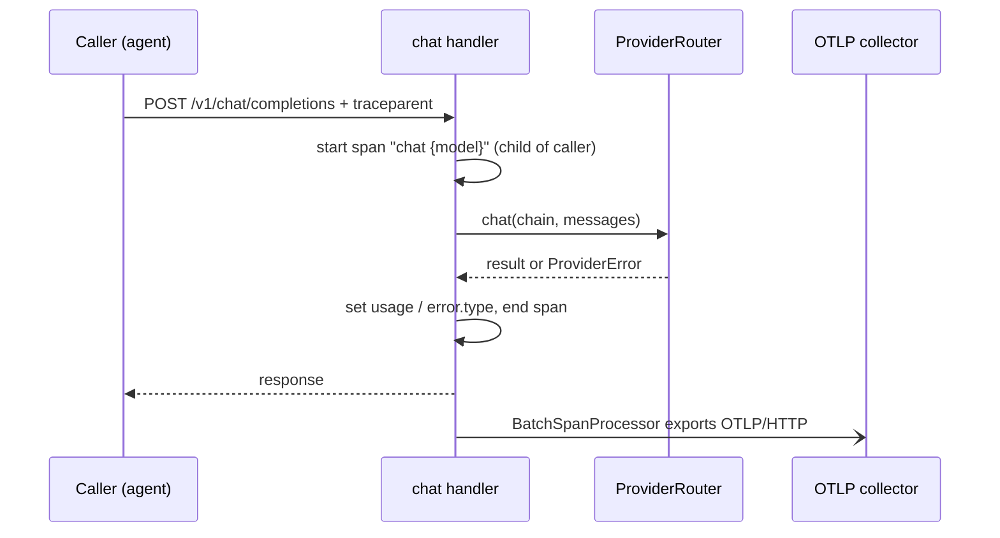
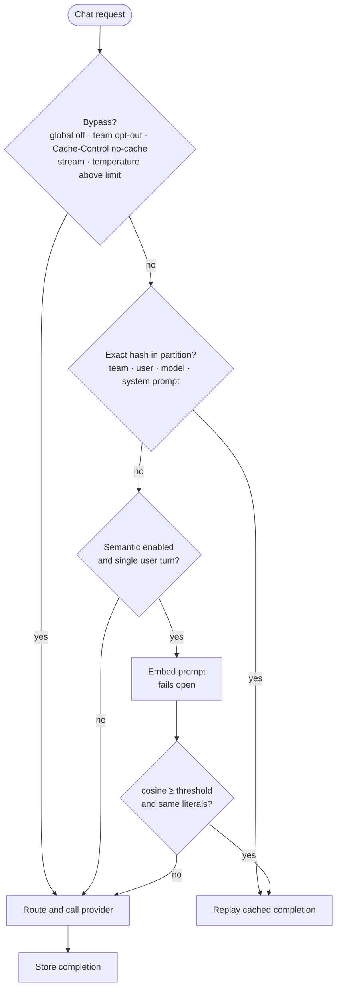
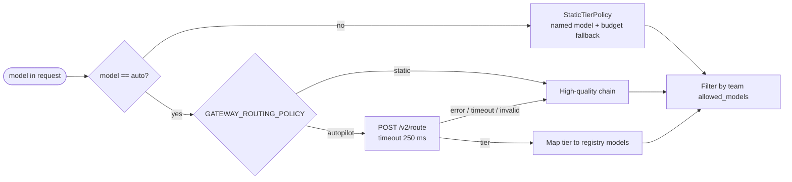
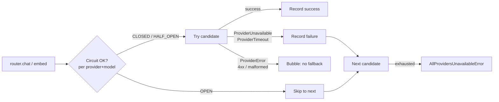
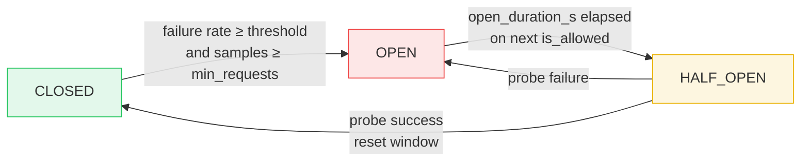
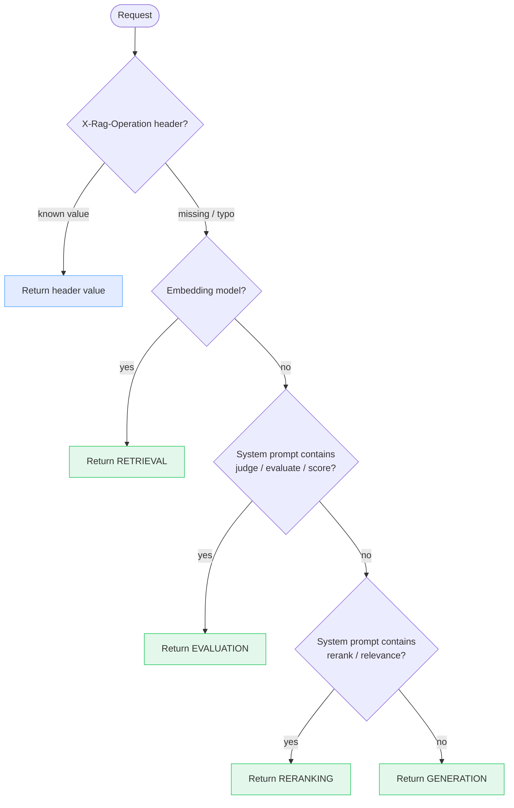

# Architecture

## High-level request lifecycle

```mermaid
flowchart LR
    Client([Client]) --> M[MetricsMiddleware<br/>counts every request]
    M --> Auth[AuthMiddleware<br/>resolves team from API key]
    Auth --> RL[RateLimitMiddleware<br/>Redis token bucket]
    RL --> H{Route}

    H -->|chat / embed| Budget[BudgetEnforcer.check<br/>warn at 80% · block at 100%]
    Budget --> Tag[classify<br/>header · model · keywords · default]
    Tag --> Cache{CompletionCache<br/>exact, then semantic}
    Cache -->|hit| Resp
    Cache -->|miss / bypass| Policy[RoutingPolicy.plan<br/>static or autopilot]
    Policy --> Router[ProviderRouter<br/>fallback chain · circuit breaker]
    Router --> Prov[Ollama HTTP<br/>inside a GenAI span]
    Prov --> Track[BudgetTracker.record<br/>SQLite cost ledger]
    Track --> Met[Metrics.record_rag_event]
    Met --> Resp[Response + X-Gateway-* headers]

    H -->|cost-report / stats / models| Read[Read-only<br/>ledger query]
    H -->|admin/teams| Admin[Resolver swap]

    style Met fill:#1f5fff20,stroke:#58a6ff
    style Track fill:#1f5fff20,stroke:#58a6ff
```

The middleware stack runs in **reverse** order of registration. The factory in
[`main.py`](../src/llm_gateway/main.py) registers `RateLimitMiddleware` first,
then `AuthMiddleware`, then `MetricsMiddleware`: so the actual flow is
metrics → auth → rate-limit → handler. Metrics is outermost so it observes
rejections too. It also adds the `Server-Timing` header and observes
`llm_gateway_overhead_seconds` when a handler reports its provider wait time
in `request.state.upstream_s` (non-streaming completions only).

## Tracing

The chat and embeddings handlers open one OTel GenAI `CLIENT` span around the
`ProviderRouter` call (for streams, around the whole generator), parented on
the request's `traceparent` header. The tracer lives on `app.state.tracer`
rather than in the global OTel provider, so each app instance owns its
pipeline and tests inject a provider with an in-memory exporter
(`create_app(tracer_provider=...)`). There is no FastAPI auto-instrumentation:
HTTP server spans would carry the client address and URL, and the eval
pipeline that reads these traces needs only the GenAI spans.

## Response cache lookup

## Routing policy

## Provider fallback chain

Streaming has a stricter contract: once the first chunk yields to the caller
the router is **committed**: a mid-stream failure raises to the client
rather than re-routing (the client has already received partial SSE bytes).

## Circuit breaker state machine

State persists to SQLite (`circuit_state` table) so a restart while a
downstream is OPEN still skips that endpoint until the duration elapses, then
probes once via HALF_OPEN. The failure-rate **window** is in-memory and
resets on restart. That's intentional: the window is for opening decisions,
not for closing ones.

## RAG operation classifier: 5-priority decision tree

The function is **pure**: handlers extract the three inputs and call
`classify(...)`. Unknown header values intentionally fall through to the
other signals so a typo doesn't bucket every request as `UNKNOWN`.

## Module boundaries

| Module | Responsibility | Key types |
|---|---|---|
| `config` | env-driven settings | `Settings`, `LogLevel` |
| `auth.models` | team-scoped policy | `TeamConfig`, `RateLimitConfig`, `BudgetConfig` |
| `auth.resolver` | YAML-backed `api_key → team` lookup, constant-time match | `TeamResolver` |
| `auth.middleware` | pure-ASGI Bearer-token validation | `AuthMiddleware` |
| `ratelimit.token_bucket` | atomic Redis Lua token bucket | `TokenBucket`, `AcquireResult` |
| `ratelimit.middleware` | 429 + `Retry-After` | `RateLimitMiddleware` |
| `budget.tracker` | computes cost, persists to ledger | `BudgetTracker` |
| `budget.enforcer` | warn at 80% / block at 100% | `BudgetEnforcer`, `BudgetDecision` |
| `rag.tagger` | 5-priority pure classifier | `classify` |
| `rag.cost_attribution` | per-day per-operation aggregator | `RagCostAttributor` |
| `rag.models` | typed enum + event/report shapes | `RagOperationType`, `RagCostEvent`, `RagCostReport` |
| `providers.base` | structural `Provider` Protocol + error hierarchy | `Provider`, `ChatMessage`, `CompletionResult`, `StreamChunk`, `EmbeddingResult` |
| `providers.ollama` | async HTTP adapter, NDJSON streaming, error normalisation | `OllamaProvider` |
| `providers.registry` | model catalogue + simulated prices | `ModelConfig`, `ProviderRegistry`, `ModelTier` |
| `providers.router` | fallback chain + circuit-breaker integration | `ProviderRouter`, `RouteCandidate`, `RouteChain` |
| `circuit_breaker.monitor` | in-memory rolling outcome window | `FailureRateMonitor` |
| `circuit_breaker.state_machine` | 3-state CB with SQLite persistence | `CircuitBreaker`, `CircuitBreakerState` |
| `cache.semantic` | exact + cosine store, literal guard, TTL, LRU, partitions | `SemanticCache`, `CachePartition`, `CachePrompt`, `CachedCompletion` |
| `cache.completion_cache` | bypass rules, fail-open lookup, store on miss | `CompletionCache`, `CacheLookup` |
| `routing.policy` | which chain serves a request; `model="auto"` | `RoutingPolicy`, `StaticTierPolicy`, `RoutingPlan` |
| `routing.autopilot` | llm-cost-autopilot sidecar adapter (route API v2 over HTTP) | `AutopilotPolicy`, `AutopilotClient` |
| `observability.metrics` | Prometheus collectors + recording helpers | `Metrics` |
| `observability.middleware` | HTTP-level auto-instrumentation | `MetricsMiddleware` |
| `observability.tracing` | OTel GenAI client spans (semconv v1.37.0) + OTLP exporter setup | `GenAiSpan`, `start_genai_span`, `build_tracer_provider` |
| `storage.db` | SQLite ledger + circuit-state repo, schema versioning | `CostLedger`, `CostLedgerEntry`, `CircuitStateRepository`, `CircuitStateRecord` |
| `api.completions` / `embeddings` / `rag` / `info` / `admin` / `health` / `metrics` | route modules, one file per concern | none |
| `main` | `create_app` factory + lifespan + middleware registration | none |

## Why these choices

- **Custom Ollama adapter (no `litellm`)**: building the adapter directly keeps the HTTP contract (streaming NDJSON, per-model token counting from `prompt_eval_count`/`eval_count`, normalised error hierarchy) visible and testable rather than hidden behind a router. `litellm` is a valid production choice; the `Provider` Protocol seam means swapping it in is an adapter and a registry entry, no churn elsewhere.
- **Pure ASGI middleware**: `BaseHTTPMiddleware` buffers response bodies, which would break the OpenAI streaming SSE response. Going straight to the ASGI `send` channel keeps streaming response bodies unbuffered.
- **Per-instance Prometheus `CollectorRegistry`**: tests construct a fresh `Metrics()` per assertion. The default global registry would leak counter values between tests; this pattern keeps the suite hermetic without resorting to `prometheus_client.REGISTRY.unregister`.
- **SQLite for circuit state, Redis for the token bucket**: they need different things. The token bucket is atomic-write-heavy and per-request; Redis Lua is the right tool. Circuit state is read-heavy with rare writes (state transitions) and must survive restart; SQLite is the right tool.
- **In-memory failure-rate window**: only used for *opening* decisions; the open state itself is persisted. Losing the window on restart causes a longer warm-up before the breaker can open again, which is the safe direction.
- **`@dataclass(frozen=True, slots=True)` everywhere**: slots save memory at scale; frozen makes the types safe to pass across threads / awaits without copy-on-mutation worries.
- **`RagOperationType` as `StrEnum`**: direct string equality works (`RagOperationType.GENERATION == "generation"`), so the storage layer can persist strings and tests can compare against literals without converting.
- **Atomic Lua token bucket**: the read/refill/decrement happens in a single Redis round-trip. The `test_concurrent_acquires_are_atomic` test fires 40 simultaneous acquires at capacity-20 and verifies exactly 20 ± 1 were allowed. Application-side locking would be racy.
- **In-process cache with numpy search**: one replica, bounded partitions (1,000 entries by default), so a matrix product is well under a millisecond and there is no network hop. The cost is a cache per replica; see [ADR 0003](adr/0003-in-process-response-cache-with-semantic-matching-off.md).
- **GenAI attribute names pinned as literals**: the semconv Python constants for GenAI live in the private `opentelemetry.semconv._incubating` package and the conventions are still in Development status, so `observability/tracing.py` is the one place to update when names move.
- **Autopilot as a sidecar, behind one module**: the gateway image stays free of torch, autopilot scales and deploys on its own, and the only file that knows its contract is `routing/autopilot.py`.
- **Header-first classification with fall-through on typos**: the caller knows best when they bother to set `X-Rag-Operation`, but a typo shouldn't poison the signal. Returning `UNKNOWN` on bad header would silently break attribution.

## Compared with LiteLLM

LiteLLM is a solid production choice; this gateway answers an adjacent question.

| Problem | Approach here |
|:--|:--|
| Per-model cost shows half the story | 5-priority RAG operation classifier; every request lands in the cost ledger with its stage, and `GET /v1/rag/cost-report` returns the breakdown. |
| A router hides the wire contract | Custom async Ollama adapter: NDJSON streaming, token counts from `prompt_eval_count` / `eval_count`, one error hierarchy (`ProviderError` / `ProviderTimeoutError` / `ProviderUnavailableError`). |
| Buffering middleware corrupts SSE | Pure ASGI auth, rate-limit and metrics middleware on the `send` channel; streams pass through unbuffered. |
| In-memory rate limiters split under load | Atomic Redis Lua token bucket: read, refill, decrement and TTL in one round trip. In the tests, 40 concurrent acquires against capacity 20 let 20 through (21 allowed for refill during the run). |
| A restart resets the circuit breaker | Three-state breaker persisted in SQLite; an `OPEN` model stays skipped across restarts until the open duration elapses. |
| Budget caps live in spreadsheets | `BudgetEnforcer` reads today's spend per request: warn at 80%, block at 100%, every check logged. |
