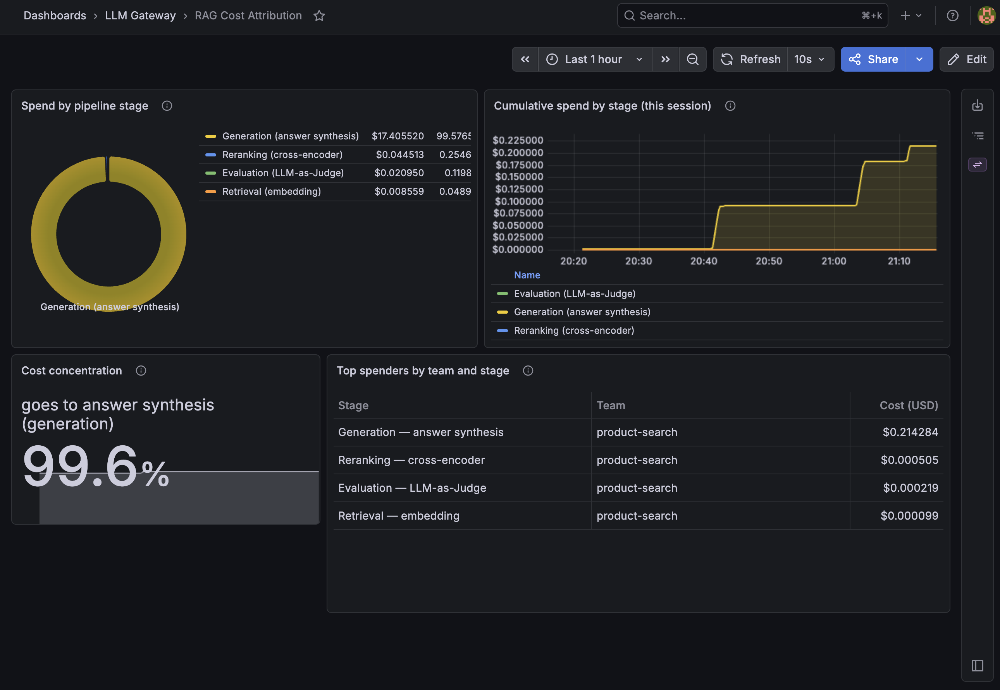
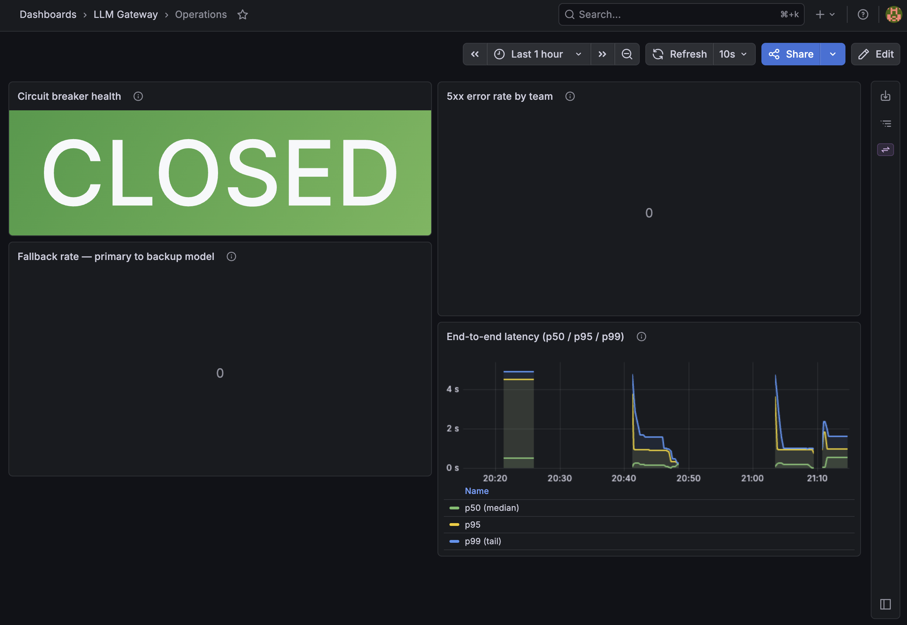
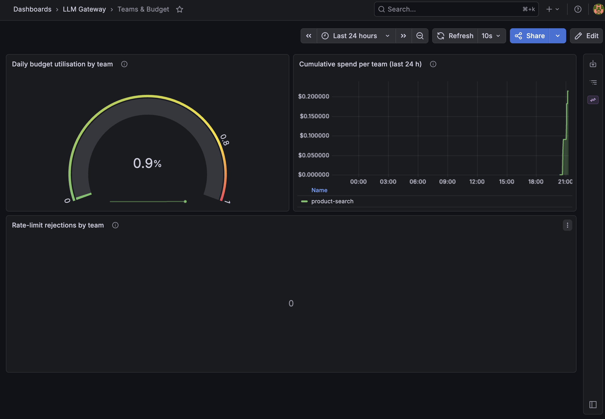

# RAG cost attribution

Every chat and embedding request is classified into one RAG operation type, and its
cost is written to a per-team, per-operation ledger. Provider dashboards say which
model cost what; this says which pipeline stage did.

## Operation types

| Type | Signal |
|:--|:--|
| `retrieval` | Embedding-model call, or `X-Rag-Operation: retrieval` |
| `reranking` | System prompt contains `rerank` / `relevance`, or `X-Rag-Operation: reranking` |
| `generation` | Default for chat requests |
| `evaluation` | System prompt contains `judge` / `evaluate` / `score`, or `X-Rag-Operation: evaluation` |
| `unknown` | Never assigned by the classifier; the ledger column default, for rows written without a tag |

The classifier is a [pure function](../src/llm_gateway/rag/tagger.py) with five
priorities: the `X-Rag-Operation` header, then the embedding-model signal, then the
`judge` / `evaluate` / `score` keywords, then the `rerank` / `relevance` keywords, then
`generation`. An
unknown header value falls through to the other signals, so a typo does not poison
attribution.

## Cost report

`GET /v1/rag/cost-report` always returns the four named operations (zero-filled when
absent) and includes `unknown` only when it carries spend:

```json
{
  "team": "product-search",
  "date": "2026-05-23",
  "total_cost_usd": 0.847,
  "by_operation": {
    "retrieval":  0.12,
    "reranking":  0.08,
    "generation": 0.58,
    "evaluation": 0.067
  }
}
```

Prices are simulated. The per-1k prices in
[`providers/registry.py`](../src/llm_gateway/providers/registry.py) drive routing and
the dashboards; the dollar amounts are illustrative, the split between operations is
what the gateway measured.

## Dashboards

Three Grafana dashboards are provisioned when the Docker Compose stack starts, and the
three demo scripts populate them (see
[development.md](development.md#full-stack-with-ollama)).

**RAG Cost Attribution**: spend by pipeline stage.



**Operations**: circuit breaker state, fallback rate, error rate, latency percentiles.



**Teams & Budget**: per-team utilisation, daily spend, rate-limit pressure.



## Load test

`scripts/load_test.py` replays a RAG mix and compares the actual cost with an
all-high-quality baseline:

```bash
uv run python scripts/load_test.py --requests 1000
```

The savings percentage it prints depends on the simulated prices above, so treat it as
a demonstration of the routing logic, not a measured saving.
