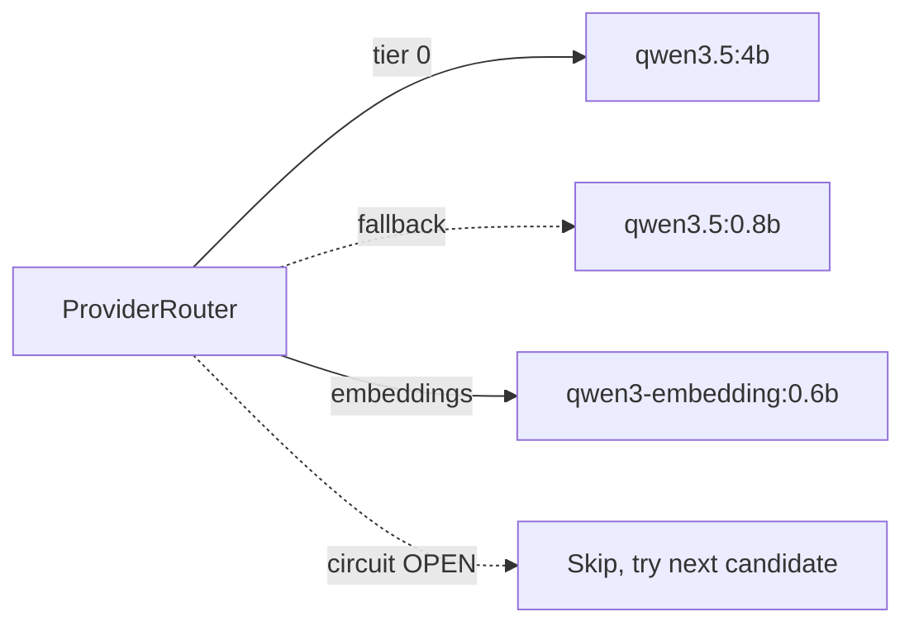

# Resilience: circuit breaker and fallback

## Fallback chain

A request for the high-quality model builds a two-candidate chain:
`qwen3.5:4b`, then `qwen3.5:0.8b`. If the primary fails or its circuit is open, the
gateway serves the request from the budget model and records a fallback event. The
caller gets a valid response, and `X-Gateway-Model-Used` says which model served it.



Streaming is stricter: a provider that fails before its first chunk is skipped like
any other failure, but once a chunk has reached the client the router is committed,
and a mid-stream failure is raised to the caller.

## Circuit breaker

One three-state machine per `(provider, model)`, persisted in SQLite:

```
CLOSED ──(failure rate ≥ 50% over ≥10 requests)─► OPEN
  ▲                                                    │
  │                                              (30 s elapses)
  │                                                    ▼
  └────────(probe request succeeds)──────────── HALF_OPEN
```

The state survives restarts: a gateway that comes back up while a model is `OPEN`
still skips it until the open duration elapses, then sends exactly one probe. The
failure-rate window itself is in memory, so a restart only delays the next opening
decision.

Thresholds: `GATEWAY_CIRCUIT_BREAKER_FAILURE_RATE_THRESHOLD`,
`GATEWAY_CIRCUIT_BREAKER_MIN_REQUESTS`, `GATEWAY_CIRCUIT_BREAKER_OPEN_DURATION_S` (see
[configuration.md](configuration.md)). The rolling window holds four times the minimum
request count, at least 40 outcomes.

## Demo

With the full Docker Compose stack running
([development.md](development.md#full-stack-with-ollama)):

```bash
uv run python scripts/demo_resilience.py
```

It stops the bundled Ollama container (or asks you to stop a host Ollama), sends
requests until the circuit opens, waits for `HALF_OPEN`, then restarts Ollama and
shows the probe closing the circuit. The Operations dashboard
(`http://localhost:3000/d/operations`) shows each transition.
